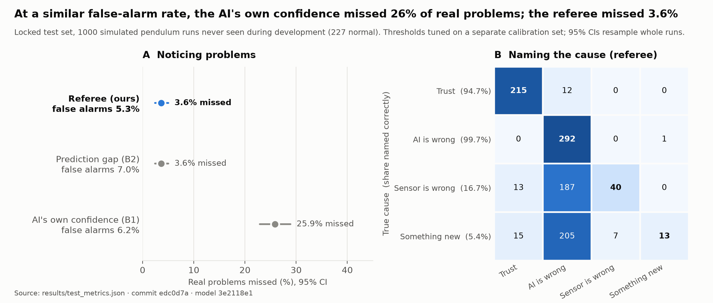

# Tellurion Referee

**When a learned world model disagrees with reality, the referee notices and says why:**
the **model** is wrong, the **sensor** is wrong, or **something new** is happening.

Built for the OSI hackathon (Oct 21–22, 2026) on a simulated pendulum, where we break reality
on purpose (a longer string, a broken sensor, a hidden magnet) so every run has a known answer.

**[Live demo](https://tellurionai.github.io/tellurion-referee/)** ·
**[Results fact sheet](docs/results_fact_sheet.md)** ·
**[Code evaluated on the locked test](https://github.com/tellurionai/tellurion-referee/tree/v0.1-hackathon-test)**



## Result

Measured **once** on a locked test set of 1,000 runs never seen during development:

| | Referee | Model's own confidence | Prediction gap |
|---|---|---|---|
| Real problems missed | **3.6%** (2.4–5.0%) | 25.9% (22.9–28.9%) | 3.6% |
| Detection AUROC | **0.981** | 0.868 | 0.982 |
| False alarms on normal runs | 5.3% | 6.2% | 7.0% |
| Naming the cause (macro-F1) | **0.472** | 0.292 | 0.365 |

- At a similar false-alarm rate, the model's own confidence missed about **1 in 4** real problems;
  the referee missed about **1 in 28**.
- Naming the cause is near perfect when the model is at fault (99.7%), but still early for sensor
  faults (16.7%) and new forces (5.4%). That's the next thing we're working on.
- All numbers with their confidence intervals, sample sizes and caveats are in the
  [fact sheet](docs/results_fact_sheet.md), generated from [`results/`](results/). None is typed by hand.

## How it works

```
reality engine ──► labelled pendulum runs (with the answer key)
world model    ──► predictions + confidence (5 networks; their disagreement = confidence)
referee        ──► at every moment: trust / model error / sensor fault / something new + evidence
evaluation     ──► scores every method on the same runs, at the same false-alarm budget
```

The referee asks four questions in order and stops at the first that settles it:

1. **Does the prediction match the sensors?** Yes → *trust*.
2. **Do the angle and speed sensors agree with each other?** No → *sensor is wrong*.
3. **Does textbook physics explain the motion?** Yes → *the model is wrong*.
4. **Does physics fit if we re-measure the pendulum (length, friction)?** Yes → *the model is wrong
   (a setting changed)*. No → *something new is acting on it*.

## Reproduce

Python 3.11+. Everything runs on a laptop CPU.

```bash
git clone https://github.com/tellurionai/tellurion-referee && cd tellurion-referee
pip install torch --index-url https://download.pytorch.org/whl/cpu   # optional: smaller CPU-only torch
pip install -e '.[dev,eval]'

make data        # generate the labelled pendulum dataset (deterministic, ~2 min)
make eval-cal    # referee + baselines on the calibration split, with the committed frozen model
make figures     # Figure 1 + the fact sheet from results/test_metrics.json
make test        # all tests, including the guard that keeps the locked test split sealed
make replays     # demo replays from the results (demo: cd demo && pnpm install && pnpm dev)
```

- `make train` retrains the 5-network world model (~5 min). The model used for every reported
  number is committed in [`models/world_model/`](models/world_model/) and checked by SHA256.
- The locked test was run once (`make eval-test`, logged in [`results/RERUNS.md`](results/RERUNS.md)).
  It refuses to run again without a stated reason.

## Repo layout
```
tellurion_sim/      reality engine: pendulum simulator, perturbations, dataset, data contract
src/referee/        world model, referee, baselines, metrics
scripts/            train / evaluate / export_replays / make_figures
models/world_model/ the frozen world model every result uses
results/ figures/   generated by scripts only
demo/               web demo (replays result files; computes nothing)
docs/               data contract, results fact sheet, build plans
```

## Limitations
- One simulated system (a single pendulum), so every run has a known answer. Real systems are next.
- Sensor faults affect the angle reading only.
- The referee's detection signal is the prediction gap, so it matches a simple gap alarm at
  *noticing* problems; its added value is *naming the cause*, which is still weak for sensor faults
  and new forces.

## Licences
Code: Apache-2.0 (`LICENSE`). Generated data: CC BY 4.0 (`DATA_LICENSE`).
